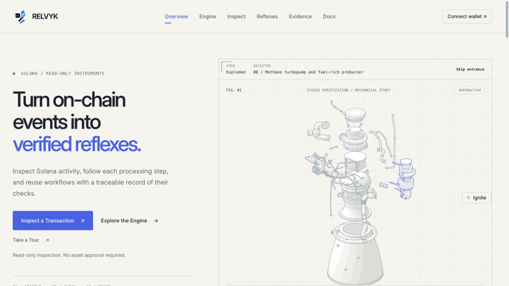
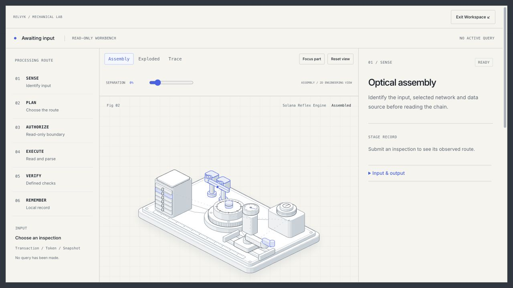
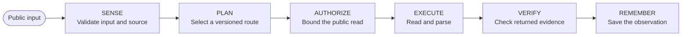

<p align="center">
  
</p>

<h1 align="center">RELVYK</h1>

<p align="center"><strong>A verifiable reflex engine for Solana.</strong><br>Public chain reads. Defined checks. Traceable evidence.</p>

<p align="center">
  <a href="https://relvyk.xyz/">Live site</a> ·
  <a href="#the-workbench">Workbench</a> ·
  <a href="#quick-start">Quick start</a> ·
  <a href="#architecture">Architecture</a> ·
  <a href="https://github.com/theovarne/RELVYK">Repository</a>
</p>

---

RELVYK turns a transaction signature, Mint address, or public account into an inspectable processing route. Its six mechanical assemblies follow the same task state as the workbench: validate the input, select a route, authorize a bounded read, execute it, check the returned data, and preserve the observation.

The application uses deterministic parsers and versioned rules. Public inspections require no wallet. It does not call an LLM, submit transactions, quote prices, or provide a cloud workspace or authentication service.

## The workbench

<p align="center">
  
</p>

<p align="center">
  
</p>

The workbench connects every observed result to its processing route, explicit checks, and source evidence.

## What you can inspect

| Capability | Implemented behavior |
| :--- | :--- |
| **Transactions** | Legacy, v0 and v1 reads; account roles, top-level and inner instructions, exact SOL/Token changes, fees, logs, raw responses, chain outcome and observed finality. Version 1 resource configuration comes from the signed message. |
| **Mint anatomy** | Original Token Program and Token-2022 Mint validation; exact supply and decimals; present, revoked or unknown authority states; parsed extensions and binary TLV inventory with explicit coverage limits. |
| **Account snapshots** | Public native SOL and owned accounts from both Token Programs. Compare two saved captures for the same address and network, grouped by Mint and program. |
| **Reflex Library** | Three executable, versioned routes; searchable capability dossiers, inspectable checks, parameterized copies and counts derived from actual saved executions. |
| **Local evidence** | IndexedDB records, summary/steps/checks/raw views, timeline or list navigation, evidence-field inspection, JSON export and deletion. Unavailable persistence is explicitly labeled as page-session storage. |
| **Replay** | Step selection, play/pause and scrubbing through saved observations. Two packaged, source-backed examples cover a Devnet transaction and a failed mainnet v1 transaction. Replay creates no new query or execution count. |
| **Mechanical interface** | Six linked assemblies, guided exploration, assemble/explode, reset, SVG focus, expanded workspace and keyboard navigation. Decorative motion respects visibility and reduced-motion preferences. |
| **Optional wallet connection** | Wallet Standard discovery and public-address connection, with rejection, disconnect and account-change handling. No message or transaction signing is requested. |

Mainnet Beta, Devnet and Testnet are explicit network choices. Times are displayed in UTC.

## One task, six stages



The model, processing steps, checks and evidence consume the same task state. Real asynchronous reads determine progress. Cancellation and new inputs invalidate stale responses.

A check reports **Checked**, **Finding**, or **Unknown**, with its evidence and limitations. A failed on-chain transaction can still be inspected successfully; its chain failure remains visible separately from inspection completion and finality.

## Quick start

Use **Node.js 24** and **pnpm 10**. The package declares Node.js 22 or newer; Node.js 24 is the recommended development version here.

```sh
git clone https://github.com/theovarne/RELVYK.git
cd RELVYK
pnpm install --frozen-lockfile
pnpm dev
```

Open [localhost:4190](http://localhost:4190). The local server runs both the static interface and `/api/rpc`. Set `PORT` to use another local port.

| Command | Purpose |
| :--- | :--- |
| `pnpm dev` / `pnpm start` | Run the local interface and read-only RPC proxy. |
| `pnpm test` | Run the Node.js test suite. |
| `pnpm lint` | Check JavaScript with ESLint. |
| `pnpm typecheck` | Check JavaScript/JSDoc types with TypeScript. |
| `pnpm build` | Generate the allowlisted static client in `public/`. |

## Server-only RPC configuration

The application uses official public Solana RPC endpoints when no override is configured. A trusted HTTPS RPC provider can be configured for each network. Public endpoints may impose rate or history limits.

For local development, copy the supplied [environment example](.env.example):

```sh
cp .env.example .env.local
```

Then set the optional values in `.env.local`; the local server loads this file.

```dotenv
SOLANA_MAINNET_RPC_URL=
SOLANA_DEVNET_RPC_URL=
SOLANA_TESTNET_RPC_URL=
```

On Vercel, set these variables in the intended deployment environment. RPC URLs and credentials belong on the server; keep them out of client configuration, committed files and exported records. No wallet, signing or model keys are required.

[src/config.js](src/config.js) contains public brand and feature configuration. Project Mint, ticker, trading URL and holder threshold remain unset. The optional project-token observer and authenticated workspace are disabled. A project address is never inferred from a reference website or sample record.

The homepage **RELVYK CA** panel reads only `tokenConfig.mint` in that configuration file. Leave it `null` until the official address is provided. Once configured, the complete address is displayed and the copy button confirms successful clipboard writes with **Copied**. No sample address is used, and setting the Mint does not enable other token features.

## Data boundaries

| Area | Scope and limits |
| :--- | :--- |
| **Transport** | Same-origin, read-only RPC proxy with predefined methods and networks. No arbitrary client-supplied endpoint or transaction submission. Requests are capped at **8 KiB**; upstream responses at **3 MiB**. |
| **Timeouts and retries** | **6.5 seconds per upstream attempt**, at most one retry for eligible failures; the client read timeout is **18 seconds**. Errors retain an explicit category and retry state. |
| **Cache provenance** | Transactions can be cached for **10 seconds**; other reads and null responses for **2 seconds**. Cached reads retain their original observation time and expose cache age. Cache, deduplication and rate controls are bounded and local to a warm server instance. |
| **Precision** | Unsafe JSON integers are preserved before numeric conversion. Balance arithmetic uses exact integers and decimal strings. Missing values stay unknown. |
| **Transactions** | Direct `jsonParsed` reads support legacy/v0/v1. Unsupported versions produce an explicit error. Version 1 priority fee is a total in lamports; configuration is not inferred from ComputeBudget instructions. |
| **Token-2022** | Returned extension state and binary type IDs are inspectable. Unparsed semantics, confidential balances, transfer hooks and metadata authenticity remain outside verified coverage. External metadata URLs are not fetched. |
| **Snapshots** | Up to **2,000 validated Token accounts** across the two program responses. Separate confirmed reads retain their interval and context slots; they are not an atomic or arbitrary historical portfolio. Missing, unreadable or truncated data remains partial. |
| **Storage and replay** | Records stay in the current browser/origin. Clearing browser data removes local history; exports are explicit local downloads. Packaged examples and replay do not refresh the chain. |

Balance differences are observations, not trading profit. Defined checks do not constitute a security audit, token endorsement or investment guarantee. The interface makes no claim to include all staking, protocol positions, compressed assets, off-chain holdings or other networks.

## Architecture

Static HTML, CSS and native ES modules keep the runtime small. There is no frontend framework, Solana SDK or LLM runtime dependency. The mechanical anatomy is SVG; the separate retained engine study uses WebGL2.

```text
RELVYK/
├── index.html · docs.html · 404.html
├── app.js · app.css · model.css     Interface and integration
├── src/
│   ├── task-engine.js              Shared task state and execution
│   ├── solana/                     Validation, RPC, exact data parsing
│   ├── reflex-library.js           Versioned routes and parameter copies
│   ├── evidence-store.js           IndexedDB and session fallback
│   ├── evidence-panel.js           Layered record and field inspection
│   ├── result-view.js              Structured result rendering
│   ├── reflex-dossiers.js          Capability dossiers
│   ├── model-controller.js         Mechanical assembly interaction
│   ├── engine-blueprint.js         Linked processing route
│   ├── replay-controller.js        Historical playback
│   ├── recorded-examples.js        Source-backed example catalogue
│   ├── examples/                   Packaged public observations
│   ├── wallet-service.js           Optional Wallet Standard connection
│   └── config.js                   Public brand and feature settings
├── api/rpc.js                      Native Vercel read-only Function
├── assets/                         RELVYK logo and icon
├── figures/                        Retained mechanical study and font
├── tests/                          Unit tests, mocks and captured fixtures
├── docs/                           Audit, verification and screenshots
├── scripts/build.mjs               Static publication allowlist
├── serve.mjs                       Local static/API server
└── vercel.json                     Build, output and Function settings
```

## Development and verification

```sh
pnpm test
pnpm lint
pnpm typecheck
pnpm build
```

The documented frontend acceptance checkpoint reports **124 passing automated tests**, plus successful lint, type checking and build checks. The suite includes synthetic inputs, mocked browser/wallet/storage/HTTP behavior and captured real RPC-response replay. That count does not represent 124 live chain queries or wallet operations.

Real observations and their UTC provenance are retained alongside the verification material. The two packaged examples are historical public records, not generated sample transactions.

- [Frontend verification and captures](docs/frontend-round-2.md)
- [Integrated verification report](docs/verification-report.md)
- [Baseline audit and data-module coverage](docs/site-audit.md)
- [Captured RPC fixture provenance](tests/fixtures/solana/provenance.json)

## Deploy on Vercel

Connect this repository to the intended Vercel project. The existing [vercel.json](vercel.json) defines a framework-free deployment:

| Setting | Value |
| :--- | :--- |
| Framework | Other / `null` |
| Build command | `npm run build` |
| Static output | `public` |
| Native Function | `api/rpc.js` |
| Function duration | `30` seconds |

The build publishes an explicit client-file allowlist. Tests, development scripts, `.env` files and the RPC implementation are excluded from static output; Vercel deploys the RPC route as a separate native Function. Configure optional RPC environment variables server-side and verify a Preview before promoting the intended production deployment.

## License and attribution

The original MIT-licensed mechanical study, illustration geometry and retained animation code keep their original authorship. [LICENSE](LICENSE) and [LICENSE-anatomy](LICENSE-anatomy) are preserved without changing their copyright notices. Retain those notices when redistributing the covered work.

RELVYK's Solana inspection, task, local evidence and wallet modules were implemented for this interface. Product branding does not transfer ownership of the original mechanical assets.

GitHub footer icon: [Primer Octicons](https://github.com/primer/octicons), distributed under its [MIT license](LICENSE-octicons).
